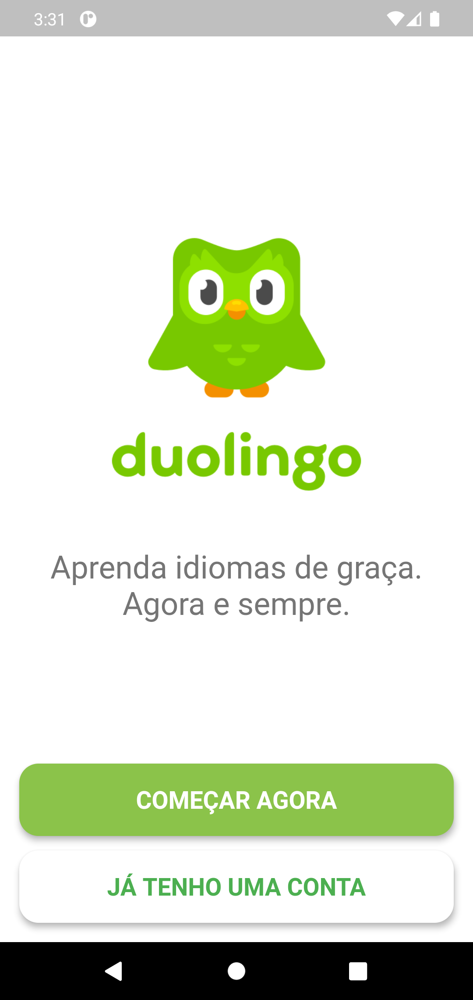
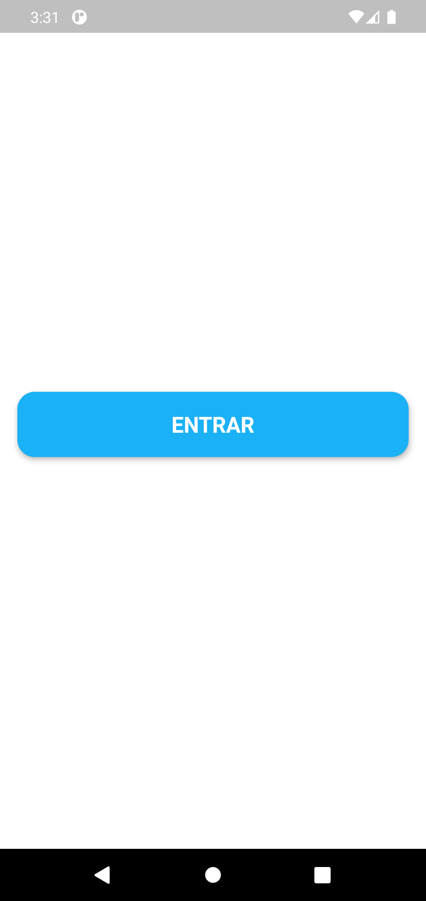

# Entrada Specification

> Spec reversa: descreve o comportamento do código em 2026-10-31. Aprovar significa "este é o comportamento a preservar". O que parece defeito está em `Assumptions & Open Questions`, não corrigido.

## Problem Statement

O aprendiz precisa chegar ao conteúdo do app sem criar conta. O app abre em uma tela de boas-vindas e dá acesso à Home com um toque, por dois caminhos.

## Goals

- [ ] Entrar no app com no máximo dois toques

## Out of Scope

| Feature | Reason |
| ------- | ------ |
| Cadastro, senha e recuperação de senha | Sem autenticação (AD-001) |
| Login Google e Firebase | Removidos (AD-001) |
| Onboarding e escolha de idioma | Não existem no código |

## Assumptions & Open Questions

| Assumption / decision | Chosen default | Rationale | Confirmed? |
| --------------------- | -------------- | --------- | ---------- |
| Lembrar quem já entrou | Não lembra: cada abertura começa nas boas-vindas | Nada é salvo no aparelho; pode ser defeito de UX | n |
| "JÁ TENHO UMA CONTA" | Leva a um login que não verifica conta | Consequência de AD-001; o rótulo promete algo que não existe | n |
| Capturas como referência | As capturas vêm do próprio app no emulador | Linha de base visual; barra de status e navegação do Android não fazem parte da spec | n |

**Open questions:** none - all resolved or logged above.

---

## User Stories

### P1: Entrar no app ⭐ MVP

**User Story**: As a aprendiz, I want entrar sem criar conta so that eu chegue direto às lições.

**Why P1**: Sem isso nenhuma outra tela é alcançada.

**Acceptance Criteria**:

1. WHEN o app é aberto THEN the system SHALL mostrar a tela em `.specs/features/entrada/captures/boas-vindas.png`
2. WHEN o aprendiz toca em "COMEÇAR AGORA" THEN the system SHALL abrir a Home
3. WHEN o aprendiz toca em "JÁ TENHO UMA CONTA" THEN the system SHALL mostrar a tela em `.specs/features/entrada/captures/login.png`
4. The system SHALL exibir no login somente o botão "ENTRAR", sem campos de texto
5. WHEN o aprendiz toca em "ENTRAR" THEN the system SHALL abrir a Home
6. WHEN o aprendiz chega à Home THEN the system SHALL remover as telas de entrada da pilha de navegação
7. WHEN o aprendiz usa o botão voltar no login THEN the system SHALL mostrar as boas-vindas
8. WHEN o aprendiz usa o botão voltar nas boas-vindas THEN the system SHALL sair do app
9. WHEN o app é reaberto depois de encerrado THEN the system SHALL mostrar as boas-vindas

**Independent Test**: abrir o app, tocar em "JÁ TENHO UMA CONTA" e em "ENTRAR" e ver a Home.

---

## Edge Cases

- WHEN a tela tem 320 pixels de largura THEN the system SHALL exibir boas-vindas e login sem estouro de layout

---

## Requirement Traceability

| Requirement ID | Story | Phase | Status |
| -------------- | ----- | ----- | ------ |
| AUTH-01 | P1: Entrar no app, AC 1 | Execute | Implementing |
| AUTH-02 | P1: Entrar no app, AC 2 | Execute | Implementing |
| AUTH-03 | P1: Entrar no app, AC 3 | Execute | Implementing |
| AUTH-04 | P1: Entrar no app, AC 4 | Execute | Implementing |
| AUTH-05 | P1: Entrar no app, AC 5 | Execute | Implementing |
| AUTH-06 | P1: Entrar no app, AC 6 | Execute | Implementing |
| AUTH-07 | P1: Entrar no app, AC 7 | Execute | Implementing |
| AUTH-08 | P1: Entrar no app, AC 8 | Execute | Implementing |
| AUTH-09 | P1: Entrar no app, AC 9 | Execute | Implementing |

**Coverage:** 9 total, 5 com teste automatizado, 4 só com walk.

---

## Differences from the source

None - the product matches the source.

## Sources

- `lib/features/auth/presentation/welcome_screen.dart`, `login_page.dart` e `lib/features/home/presentation/home_shell.dart` - comportamento
-  - binding - tela inicial com logo, frase e dois botões
-  - binding - login com um único botão

---

## Success Criteria

- [ ] Da abertura à Home sem conta

## Checks

**Mutations**: 3
**Build**: `flutter analyze; flutter build apk --debug`

**C1** - A abertura mostra as boas-vindas (AUTH-01, AC 1)
Proof: walk - abrir o app mostra as boas-vindas

**C2** - "COMEÇAR AGORA" abre a Home, sem volta (AUTH-02, AC 2; AUTH-06, AC 6)
Proof: `flutter test test/app_test.dart --plain-name "COMECAR AGORA abre a Home sem volta"`

**C3** - "JÁ TENHO UMA CONTA" abre o login (AUTH-03, AC 3)
Proof: `flutter test test/app_test.dart --plain-name "JA TENHO UMA CONTA abre o login"`

**C4** - O login só tem o botão "ENTRAR" (AUTH-04, AC 4)
Proof: `flutter test test/login_page_test.dart --plain-name "login mostra apenas o botao ENTRAR"`

**C5** - "ENTRAR" abre a Home (AUTH-05, AC 5)
Proof: `flutter test test/login_page_test.dart --plain-name "tocar em ENTRAR abre a Home"`

**C6** - Voltar no login mostra as boas-vindas (AUTH-07, AC 7)
Proof: walk - botão voltar do Android no login

**C7** - Voltar nas boas-vindas sai do app (AUTH-08, AC 8)
Proof: walk - botão voltar do Android nas boas-vindas

**C8** - Reabrir o app mostra as boas-vindas (AUTH-09, AC 9)
Proof: walk - encerrar e abrir de novo depois de entrar

**C9** - Boas-vindas e login não estouram em 320 pixels (Edge Cases)
Proof: `flutter test test/app_test.dart --plain-name "nenhuma tela estoura"`

## Handoff

**Walked:** 2026-10-31, Android 11 em emulador: abertura mostrou as boas-vindas; "JÁ TENHO UMA CONTA" mostrou o login; voltar no login mostrou as boas-vindas; voltar nas boas-vindas saiu do app; "COMEÇAR AGORA" e "ENTRAR" abriram a Home; encerrar e reabrir mostrou as boas-vindas.
