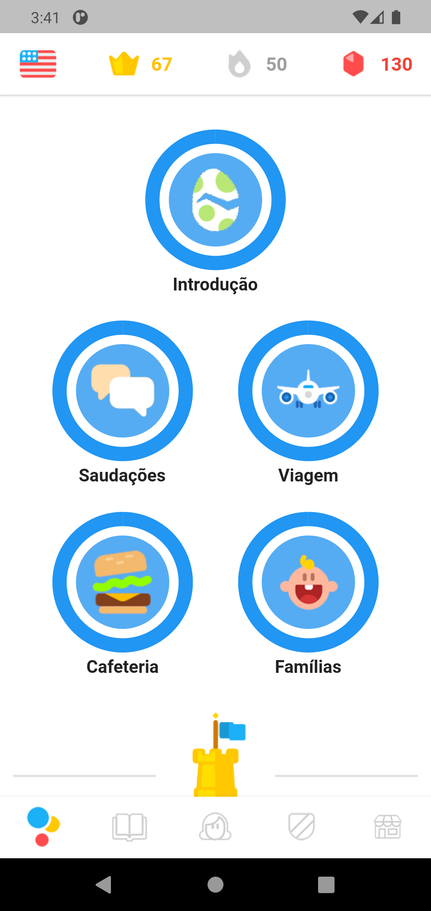
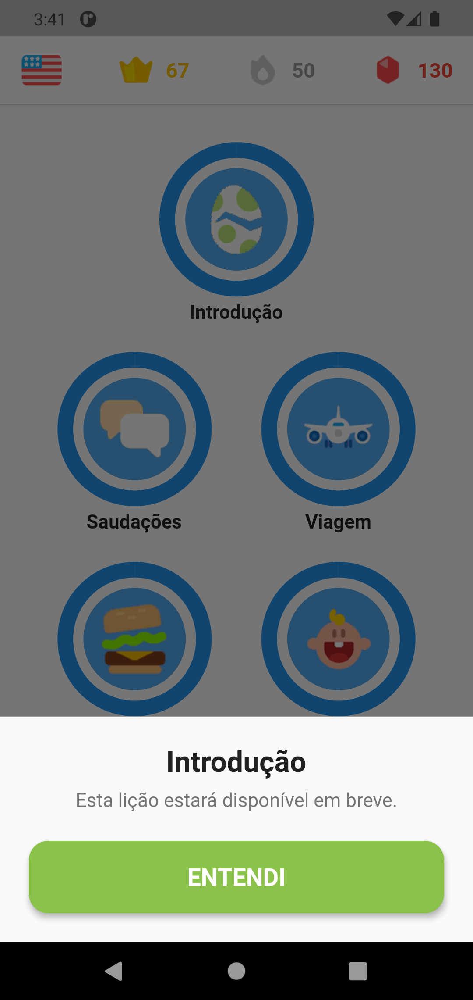

# Mapa de lições Specification

> Spec reversa: descreve o comportamento do código em 2026-10-31. Aprovar significa "este é o comportamento a preservar". O que parece defeito está em `Assumptions & Open Questions`, não corrigido.

## Problem Statement

A aba Lições mostra o caminho de aprendizado. Hoje o mapa é só uma vitrine: as lições não abrem, porque a tela de lição não existe, e só a "Introdução" reage ao toque.

## Goals

- [ ] Mostrar as cinco lições na ordem do caminho
- [ ] Informar que a Introdução ainda não está disponível

## Out of Scope

| Feature | Reason |
| ------- | ------ |
| Tela de lição, exercícios e tela de resultado | Não existem no código |
| Vidas, XP ganho e progresso real | Não existem no código |
| Bloqueio e desbloqueio sequencial | Não existe no código |
| Toque no castelo | É só visual |

## Assumptions & Open Questions

| Assumption / decision | Chosen default | Rationale | Confirmed? |
| --------------------- | -------------- | --------- | ---------- |
| Anel de progresso | 100% cheio em todas as lições, e leitores de tela anunciam "100%" | Herdado; sugere lições concluídas sem nenhum progresso real | n |
| Lições sem reação | As quatro lições além da Introdução não reagem e têm a mesma aparência da que reage | O pedido tratou só do ovo; o aprendiz não distingue as duas | n |
| Texto do painel | "Esta lição estará disponível em breve." | A lição ainda não existe | n |
| Rótulo do toque em leitor de tela | Sem rótulo próprio no círculo | O título fica fora da área de toque | n |

**Open questions:** none - all resolved or logged above.

---

## User Stories

### P1: Ver o caminho ⭐ MVP

**User Story**: As a aprendiz, I want ver as lições em ordem so that eu entenda o caminho de aprendizado.

**Why P1**: É o conteúdo da tela principal.

**Acceptance Criteria**:

1. WHILE a aba Lições estiver ativa the system SHALL mostrar a tela em `.specs/features/licoes/captures/mapa.png`, com Introdução; Saudações e Viagem; Cafeteria e Famílias; e o castelo de ponto de controle
2. WHEN o conteúdo não cabe na tela THEN the system SHALL permitir rolagem vertical

**Independent Test**: abrir a Home e rolar o mapa até o castelo.

---

### P2: Tocar na Introdução

**User Story**: As a aprendiz, I want tocar na Introdução so that eu saiba o estado da lição.

**Why P2**: Evita que o principal elemento da tela pareça quebrado.

**Acceptance Criteria**:

1. WHEN o aprendiz toca no círculo "Introdução" THEN the system SHALL mostrar o painel em `.specs/features/licoes/captures/painel-introducao.png`
2. WHEN o aprendiz toca em "ENTENDI" THEN the system SHALL fechar o painel
3. WHEN o aprendiz toca em outra lição THEN the system SHALL manter o painel fechado

**Independent Test**: tocar no ovo, ver o painel e fechá-lo em "ENTENDI".

---

## Requirement Traceability

| Requirement ID | Story | Phase | Status |
| -------------- | ----- | ----- | ------ |
| LESSON-01 | P1: Ver o caminho, AC 1 | Execute | Implementing |
| LESSON-02 | P1: Ver o caminho, AC 2 | Execute | Implementing |
| LESSON-03 | P2: Tocar na Introdução, AC 1 | Execute | Implementing |
| LESSON-04 | P2: Tocar na Introdução, AC 2 | Execute | Implementing |
| LESSON-05 | P2: Tocar na Introdução, AC 3 | Execute | Implementing |

**Coverage:** 5 total, 3 com teste automatizado, 2 só com walk.

---

## Differences from the source

None - the product matches the source.

## Sources

- `lib/features/lessons/presentation/lessons_screen.dart` e `lesson_bubble.dart` - comportamento
- `.specs/features/interacao-introducao/spec.md` - pedido que criou o painel
-  - binding - mapa de lições com barra superior e abas
-  - binding - painel aberto sobre o mapa

---

## Success Criteria

- [ ] Do ovo ao painel com um toque

## Checks

**Mutations**: 3
**Build**: `flutter analyze; flutter build apk --debug`

**C1** - O mapa mostra as lições na ordem (LESSON-01, AC 1)
Proof: walk - abrir a aba Lições

**C2** - O mapa rola até o castelo (LESSON-02, AC 2)
Proof: walk - deslizar o mapa para cima

**C3** - Tocar no ovo abre o painel, e ENTENDI fecha (LESSON-03, AC 1; LESSON-04, AC 2)
Proof: `flutter test test/app_test.dart --plain-name "tocar no ovo abre o painel e ENTENDI fecha"`

**C4** - Tocar em outra lição não abre o painel (LESSON-05, AC 3)
Proof: `flutter test test/app_test.dart --plain-name "tocar em outra licao nao abre o painel"`

## Handoff

**Walked:** 2026-10-31, Android 11 em emulador: a Home abriu no mapa; o deslize mostrou o castelo inteiro; tocar em Viagem não abriu nada; tocar no ovo abriu o painel; "ENTENDI" fechou o painel.
