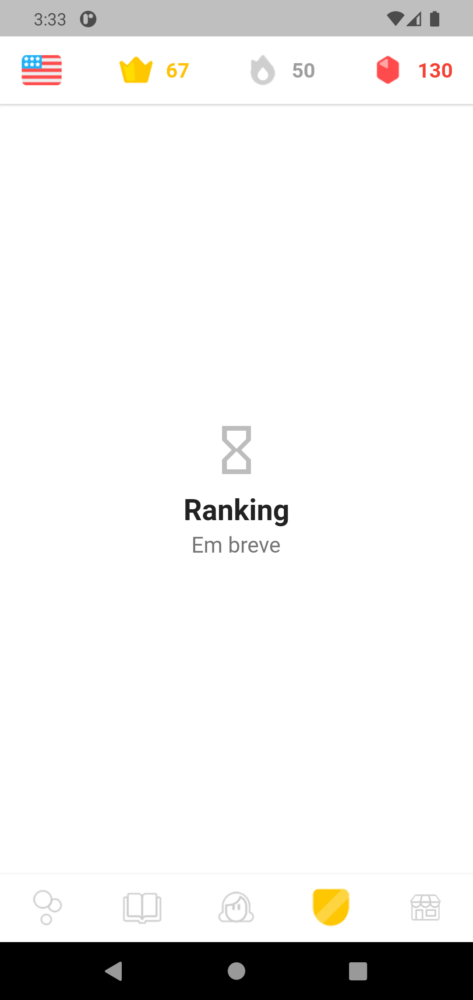

# Navegação principal Specification

> Spec reversa: descreve o comportamento do código em 2026-10-31. Aprovar significa "este é o comportamento a preservar". O que parece defeito está em `Assumptions & Open Questions`, não corrigido.

## Problem Statement

Depois de entrar, o aprendiz precisa alternar entre as áreas do app e ver seus indicadores. A Home tem uma barra superior com indicadores e uma barra inferior com cinco abas, e três delas ainda não têm conteúdo.

## Goals

- [ ] Alcançar qualquer área do app com um toque
- [ ] Não perder a posição ao trocar de aba

## Out of Scope

| Feature | Reason |
| ------- | ------ |
| Conteúdo de Histórias, Ranking e Loja | Só existe a tela "Em breve" |
| Troca de idioma pela bandeira | A bandeira é só visual |
| Valores reais de coroas, ofensiva e gemas | Não há progresso real |
| Modo paisagem | O app força retrato |

## Assumptions & Open Questions

| Assumption / decision | Chosen default | Rationale | Confirmed? |
| --------------------- | -------------- | --------- | ---------- |
| Indicadores da barra superior | Coroas 67, ofensiva 50, gemas 130, fixos em `lib/core/demo_stats.dart` | Dados de demonstração | n |
| Toque nos indicadores e na bandeira | Sem reação | Foram removidos os botões sem ação | n |
| Orientação no iOS | Forçada em retrato pelo código, embora o `Info.plist` declare paisagem | Divergência de configuração; iOS não foi testado | n |
| Identificadores Android | `applicationId` `com.flutter.duolingo` e pacote `com.example.duolingo` | Herdado; precisa de decisão antes de publicar | n |
| Toque em Ranking que abriu Loja | Tratado como não reproduzido | Ocorreu 1 vez; 11 repetições e o teste de todas as combinações abriram a aba correta | n |

**Open questions:** none - all resolved or logged above.

---

## User Stories

### P1: Trocar de área ⭐ MVP

**User Story**: As a aprendiz, I want trocar de aba so that eu acesse cada área do app.

**Why P1**: É a navegação de todo o app.

**Acceptance Criteria**:

1. The system SHALL exibir as abas na ordem Lições, Histórias, Perfil, Ranking e Loja, com Lições ativa ao chegar à Home
2. WHEN o aprendiz toca em uma aba THEN the system SHALL tornar essa aba a ativa e destacar o ícone dela
3. WHEN o aprendiz volta à aba Lições THEN the system SHALL manter a posição de rolagem
4. WHILE Histórias, Ranking ou Loja estiver ativa the system SHALL exibir o título da aba e o texto "Em breve", como em `.specs/features/navegacao/captures/em-breve.png`
5. WHEN o aprendiz usa o botão voltar na Home THEN the system SHALL sair do app

**Independent Test**: tocar nas cinco abas e ver o conteúdo de cada uma.

---

### P2: Ver indicadores

**User Story**: As a aprendiz, I want ver meus indicadores so that eu acompanhe meu avanço.

**Why P2**: Informativo; os valores ainda são fictícios.

**Acceptance Criteria**:

1. The system SHALL exibir na barra superior a bandeira e os valores 67 de coroas, 50 de ofensiva e 130 de gemas, em todas as abas
2. The system SHALL anunciar aos leitores de tela "Coroas: 67", "Ofensiva: 50" e "Gemas: 130"

**Independent Test**: abrir cada aba e conferir a barra superior.

---

### P3: Manter o retrato

**User Story**: As a aprendiz, I want uma orientação estável so that o layout não mude ao girar o aparelho.

**Why P3**: Conveniência.

**Acceptance Criteria**:

1. WHILE o app estiver aberto the system SHALL manter a orientação em retrato

**Independent Test**: pedir rotação ao sistema e ver o app continuar em retrato.

---

## Edge Cases

- WHEN a tela tem 320 pixels de largura THEN the system SHALL exibir todas as abas sem estouro de layout

---

## Requirement Traceability

| Requirement ID | Story | Phase | Status |
| -------------- | ----- | ----- | ------ |
| SHELL-01 | P1: Trocar de área, AC 1 | Execute | Implementing |
| SHELL-02 | P1: Trocar de área, AC 2 | Execute | Implementing |
| SHELL-03 | P1: Trocar de área, AC 3 | Execute | Implementing |
| SHELL-04 | P1: Trocar de área, AC 4 | Execute | Implementing |
| SHELL-05 | P1: Trocar de área, AC 5 | Execute | Implementing |
| SHELL-06 | P2: Ver indicadores, AC 1 | Execute | Implementing |
| SHELL-07 | P2: Ver indicadores, AC 2 | Execute | Implementing |
| SHELL-08 | P3: Manter o retrato, AC 1 | Execute | Implementing |

**Coverage:** 8 total, 2 com teste automatizado, 6 só com walk.

---

## Differences from the source

None - the product matches the source.

## Sources

- `lib/features/home/presentation/home_shell.dart`, `stats_app_bar.dart`, `lib/shared/widgets/coming_soon.dart` e `lib/main.dart` - comportamento
-  - binding - aba sem conteúdo, com a barra superior e as cinco abas

---

## Success Criteria

- [ ] Todas as abas alcançáveis com um toque

## Checks

**Mutations**: 3
**Build**: `flutter analyze; flutter build apk --debug`

**C1** - As abas aparecem na ordem definida (SHELL-01, AC 1)
Proof: walk - conferir a ordem na barra inferior

**C2** - Tocar em uma aba a torna ativa, em todas as combinações (SHELL-02, AC 2)
Proof: `flutter test test/app_test.dart --plain-name "tocar em uma aba troca a aba ativa"`

**C3** - A rolagem das lições é preservada (SHELL-03, AC 3)
Proof: `flutter test test/app_test.dart --plain-name "trocar de aba preserva a rolagem das licoes"`

**C4** - Abas sem conteúdo mostram "Em breve" (SHELL-04, AC 4)
Proof: walk - abrir Histórias, Ranking e Loja

**C5** - Voltar na Home sai do app (SHELL-05, AC 5)
Proof: walk - botão voltar do Android na Home

**C6** - A barra superior mostra os indicadores (SHELL-06, AC 1)
Proof: walk - conferir os valores em cada aba

**C7** - Os indicadores têm rótulo de acessibilidade (SHELL-07, AC 2)
Proof: walk - árvore de acessibilidade pelo `uiautomator dump`

**C8** - O app continua em retrato ao pedir rotação (SHELL-08, AC 1)
Proof: walk - forçar `user_rotation` 1 no emulador

**C9** - As abas não estouram em 320 pixels (Edge Cases)
Proof: `flutter test test/app_test.dart --plain-name "nenhuma tela estoura"`

## Handoff

**Walked:** 2026-10-31, Android 11 em emulador: as cinco abas abriram; Histórias, Ranking e Loja mostraram "Em breve"; voltar na Home saiu do app; a barra superior e os rótulos "Coroas: 67", "Ofensiva: 50" e "Gemas: 130" apareceram na árvore de acessibilidade; com `user_rotation` 1, a rotação ficou em 0.
