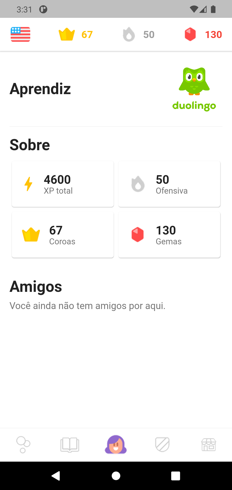

# Perfil Specification

> Spec reversa: descreve o comportamento do código em 2026-10-31. Aprovar significa "este é o comportamento a preservar". O que parece defeito está em `Assumptions & Open Questions`, não corrigido.

## Problem Statement

A aba Perfil resume quem é o aprendiz e seus números. Como não há conta nem progresso real, a tela é somente leitura e mostra dados de demonstração.

## Goals

- [ ] Mostrar nome, indicadores e amigos em uma tela

## Out of Scope

| Feature | Reason |
| ------- | ------ |
| Editar nome e foto | Sem conta (AD-001) |
| Adicionar amigos | O botão sem ação foi removido |
| Conquistas e configurações | Não existem no código |

## Assumptions & Open Questions

| Assumption / decision | Chosen default | Rationale | Confirmed? |
| --------------------- | -------------- | --------- | ---------- |
| Nome do aprendiz | "Aprendiz", fixo | Sem conta não há nome | n |
| Foto de perfil | Logo do Duolingo | Herdado; não representa o aprendiz | n |
| XP total | 4600, fixo em `lib/core/demo_stats.dart` | Dado de demonstração | n |
| Amigos | Sempre vazio | Não há como adicionar amigos | n |

**Open questions:** none - all resolved or logged above.

---

## User Stories

### P1: Ver meu perfil ⭐ MVP

**User Story**: As a aprendiz, I want ver meu perfil so that eu acompanhe meus números.

**Why P1**: É o único conteúdo da tela.

**Acceptance Criteria**:

1. WHILE a aba Perfil estiver ativa the system SHALL mostrar a tela em `.specs/features/perfil/captures/perfil.png`
2. The system SHALL exibir o nome "Aprendiz" e a imagem de perfil no topo da tela
3. The system SHALL exibir em "Sobre" os cards 4600 XP total, 50 Ofensiva, 67 Coroas e 130 Gemas
4. The system SHALL exibir em "Amigos" o texto "Você ainda não tem amigos por aqui."
5. The system SHALL mostrar a ofensiva, as coroas e as gemas com os mesmos valores da barra superior

**Independent Test**: abrir a aba Perfil e conferir os valores com a barra superior.

---

## Edge Cases

- WHEN a tela tem 320 pixels de largura THEN the system SHALL exibir os quatro cards em duas colunas, sem estouro de layout

---

## Requirement Traceability

| Requirement ID | Story | Phase | Status |
| -------------- | ----- | ----- | ------ |
| PROFILE-01 | P1: Ver meu perfil, AC 1 | Execute | Implementing |
| PROFILE-02 | P1: Ver meu perfil, AC 2 | Execute | Implementing |
| PROFILE-03 | P1: Ver meu perfil, AC 3 | Execute | Implementing |
| PROFILE-04 | P1: Ver meu perfil, AC 4 | Execute | Implementing |
| PROFILE-05 | P1: Ver meu perfil, AC 5 | Execute | Implementing |

**Coverage:** 5 total, 0 com teste automatizado de conteúdo, 5 só com walk.

---

## Differences from the source

None - the product matches the source.

## Sources

- `lib/features/profile/presentation/profile_screen.dart` e `lib/core/demo_stats.dart` - comportamento
-  - binding - perfil com nome, imagem, quatro cards e amigos

---

## Success Criteria

- [ ] Valores do perfil iguais aos da barra superior

## Checks

**Mutations**: 3
**Build**: `flutter analyze; flutter build apk --debug`

**C1** - A tela corresponde à captura (PROFILE-01, AC 1)
Proof: walk - abrir a aba Perfil

**C2** - Nome e imagem aparecem no topo (PROFILE-02, AC 2)
Proof: walk - conferir o topo da tela

**C3** - Os quatro cards mostram os valores (PROFILE-03, AC 3)
Proof: walk - árvore de acessibilidade pelo `uiautomator dump`

**C4** - Amigos mostra o texto de vazio (PROFILE-04, AC 4)
Proof: walk - conferir a seção Amigos

**C5** - Os valores coincidem com a barra superior (PROFILE-05, AC 5)
Proof: walk - comparar os cards com a barra superior

**C6** - O perfil não estoura em 320 pixels (Edge Cases)
Proof: `flutter test test/app_test.dart --plain-name "nenhuma tela estoura"`

## Handoff

**Walked:** 2026-10-31, Android 11 em emulador: a aba Perfil mostrou "Aprendiz", a imagem, os cards 4600, 50, 67 e 130 e o texto de amigos vazio; os valores coincidiram com a barra superior.
