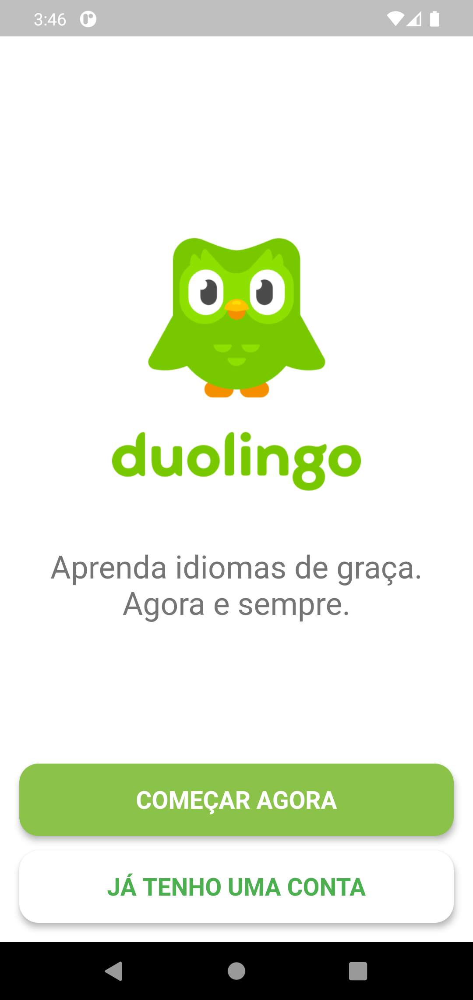
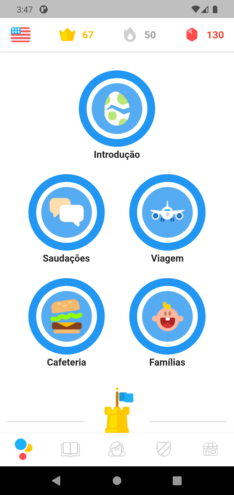
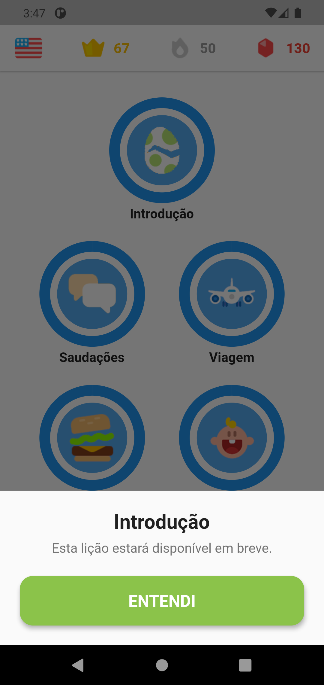
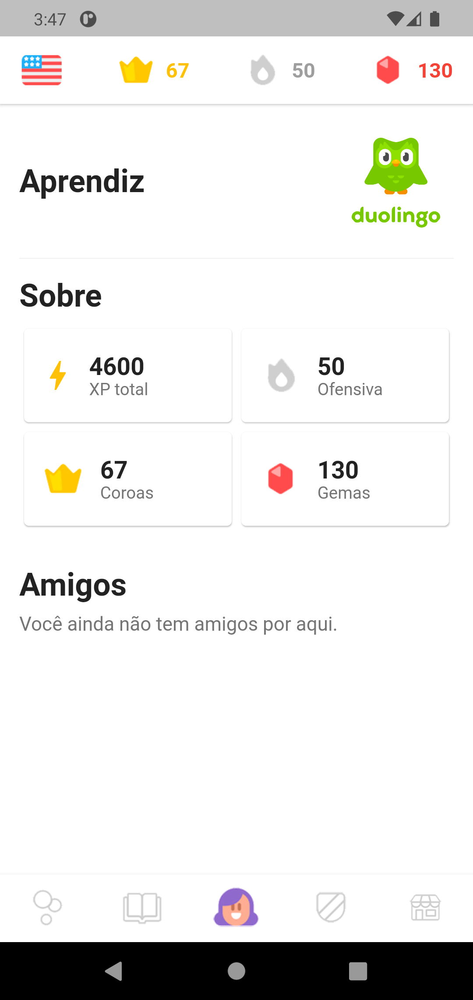

# Duolingo Flutter

An educational Duolingo clone built with Flutter: a gamified app (sequential lessons, progress, lives, XP, streaks) with screens styled after the original (home, lesson, results, store, leaderboard, profile).

## Screenshots

| Welcome | Lessons | Lesson | Profile |
| --- | --- | --- | --- |
|  |  |  |  |
| Get started or log in. | Lesson path and counters. | Introduction lesson panel. | Name, XP, streak, crowns and gems. |

The app's UI is in Portuguese. Lessons don't open exercises yet, and the Stories, Leaderboard and Store tabs show a "coming soon" placeholder.

## Getting started

### Requirements

The project was last built and tested with:

- Flutter 2.0.6 (stable channel), which includes Dart 2.12.3
- Java 8
- Android SDK, plus a device or emulator (tested on Android 11, API 30)

Use this Flutter version. `pubspec.yaml` requires Dart `<3.0.0`, so Flutter releases that ship Dart 3 won't resolve the project, and other versions are untested. To install it:

```sh
git clone -b 2.0.6 https://github.com/flutter/flutter.git
```

Then add the `flutter/bin` folder to your `PATH`.

### Run

```sh
git clone https://github.com/ollinmagno/duolingo-flutter.git
cd duolingo-flutter
flutter pub get
flutter devices
flutter run -d <device-id>
```

Replace `<device-id>` with an ID listed by `flutter devices`.

### Test

```sh
flutter test
```

## Trademark notice

This is an independent study project. It is not affiliated with, endorsed by, or sponsored by Duolingo, Inc.

Duolingo, the Duolingo logo and the Duo mascot are trademarks of Duolingo, Inc. They appear here for educational purposes only. This project is non-commercial and should not be published to app stores or presented as an official Duolingo product.

## Star History

[](https://www.star-history.com/?repos=ollinmagno%2Fduolingo-flutter&type=date&legend=top-left)
